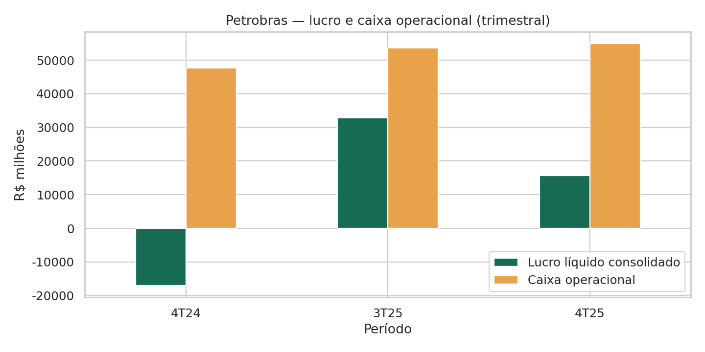
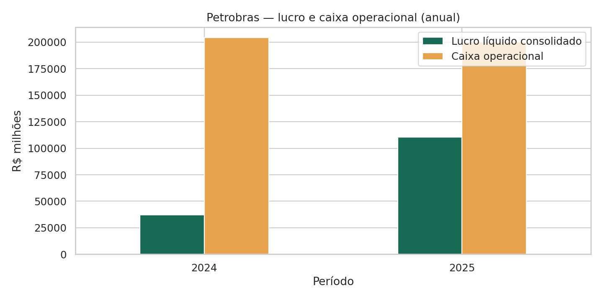
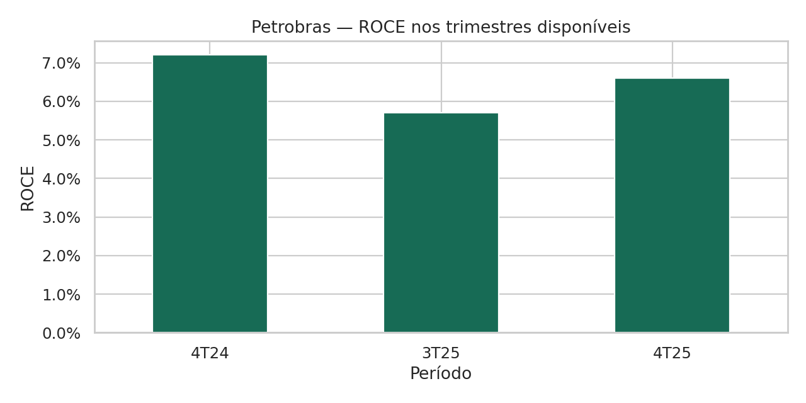

# Petrobras 4T25 — análise de resultados com Python

**Autor:** Cassius Marcellus Brasil Rios Campos  
Portfólio para Analista de Dados Júnior | Estudante de Ciências Contábeis — UFAM  
[Perfil no GitHub](https://github.com/rioscassius)

## Objetivo

Organizar dados de divulgação financeira da Petrobras e explorar a relação entre resultado contábil, geração de caixa e indicadores de desempenho. O projeto combina conhecimentos de contabilidade com tratamento e visualização de dados em Python.

## Perfil profissional

Estudante de Ciências Contábeis da UFAM, com experiência em rotinas administrativas e financeiras, análise de prestação de contas e conciliação bancária. Em transição para análise de dados, com interesse em transformar dados financeiros em informações claras para apoiar decisões.

Este projeto demonstra aplicação de Python e pandas em uma base real de divulgação financeira, com organização de dados, visualizações e comparação de indicadores. Foi desenvolvido como projeto de estudo e portfólio, com apoio de IA.

## Perguntas de negócio

1. Como o lucro líquido consolidado e o caixa operacional se comparam nos períodos disponíveis?
2. A melhora do lucro anual acompanha aumento na geração de caixa operacional?
3. Como o ROCE variou em relação ao trimestre anterior disponível e ao mesmo trimestre de 2024?
4. Como organizar indicadores de moedas e escalas diferentes para evitar comparações inadequadas?

## Competências demonstradas

| Competência | Evidência no projeto |
|---|---|
| Preparação de dados | Leitura de Excel, limpeza de rótulos e padronização de períodos |
| Modelagem de tabelas | Formato longo com origem, indicador, período e unidade |
| Qualidade de dados | Conferência de chaves duplicadas, unidades e correspondência dos períodos |
| Análise exploratória | Comparação descritiva entre lucro e caixa e acompanhamento do ROCE |
| Visualização | Gráficos estáticos e painel com filtros por unidade e periodicidade |
| Comunicação | Conclusões objetivas, fonte identificada e limitações documentadas |

## Dados e escopo

Fonte: [Central de Resultados da Petrobras](https://www.investidorpetrobras.com.br/resultados-e-comunicados/central-de-resultados/). Arquivo Excel de resultados do 4T25 fornecido para o projeto, preservado em `dados/resultados_4t25.xlsx`.

Foram tratadas três das 21 abas: **Principais indicadores, DRE e DFC**. A base final contém **430 registros**. Períodos: 4T24, 3T25, 4T25, 2024 e 2025. Os trimestres não representam uma série contínua.

## Ferramentas e tratamento

Python, pandas, openpyxl, NumPy, Matplotlib, Seaborn e ipywidgets, com desenvolvimento no Google Colab.

- Padronização de nomes e períodos, mantendo os nomes originais.
- Transformação para formato longo e preservação de valores negativos.
- Separação de períodos anuais e trimestrais, moedas, escalas e unidades.
- Tratamento de traços e vazios como ausentes, sem preenchimento por zero.
- Recuperação de dólar médio, Brent, preço dos derivados e ROCE.
- Painel interativo com filtros por demonstrativo, periodicidade e unidade.
- Comparação descritiva de lucro líquido consolidado e caixa operacional.

## Principais observações

- No 4T25, o lucro líquido consolidado foi R$ 15,653 bilhões e o caixa operacional foi R$ 54,916 bilhões. A diferença de R$ 39,263 bilhões é descritiva; sua explicação exige analisar os ajustes da DFC.
- Entre 2024 e 2025, o lucro líquido consolidado passou de R$ 37,009 bilhões para R$ 110,605 bilhões, enquanto o caixa operacional passou de R$ 204,037 bilhões para R$ 200,333 bilhões. A melhora do lucro não foi acompanhada de aumento do caixa operacional nesse comparativo.
- O ROCE foi 7,2% no 4T24, 5,7% no 3T25 e 6,6% no 4T25: recuperação de 0,9 ponto percentual frente ao 3T25 e redução de 0,6 ponto percentual frente ao 4T24.

Estas observações não atribuem causas às variações. Lucro consolidado inclui acionistas não controladores e difere do lucro atribuível aos acionistas Petrobras.

## Visualizações

## Como executar

**Google Colab:** abra [Colab](https://colab.research.google.com/), escolha abrir um notebook e faça upload de `PETROBRAS_4T25_portfolio.ipynb`. Execute as células na ordem. Quando solicitado, envie `dados/resultados_4t25.xlsx`. Para comparar vários indicadores, selecione-os no painel usando Ctrl ou Command.

**Jupyter local:** abra um terminal na pasta do projeto, instale as dependências com `python -m pip install -r requirements.txt` e inicie `python -m jupyterlab`. Abra o notebook e execute na ordem. Mantenha a pasta `dados` ao lado do notebook.

No GitHub, o notebook é apresentado de forma estática. Para usar os filtros, execute no Colab ou Jupyter. Os gráficos deste README oferecem uma prévia sem execução.

## Validação e limites

O tratamento e os gráficos estáticos foram reexecutados com o Excel original. Foram conferidos 430 registros, ausência de duplicatas na chave aba/indicador/período, unidades preenchidas, períodos padronizados e os valores da comparação de lucro com caixa. O ROCE do painel foi conferido visualmente no Colab pelo autor durante a elaboração.

Os demais filtros da versão empacotada ainda devem ser conferidos no Colab. O ambiente de revisão não dispõe de ipywidgets; não foi feita validação automatizada da interação. O código depende de posições de linhas e colunas específicas deste arquivo. Valores não conversíveis são tratados como ausentes nas funções originais; uma evolução é registrar cada falha de conversão.

Não foram feitas inferências de causalidade ou correlação com períodos sobrepostos. A análise não constitui auditoria contábil. Os subtotais e totais permanecem na base: somar todas as linhas de um demonstrativo pode gerar dupla contagem.

## Apoio de IA

Projeto desenvolvido com apoio de ChatGPT e Gemini na elaboração e revisão do código. O notebook documenta o tratamento, as verificações realizadas e as limitações. A apresentação do trabalho deve incluir a explicação das decisões e a conferência dos resultados pelo autor.

## Arquivos

| Arquivo | Conteúdo |
|---|---|
| `PETROBRAS_4T25_portfolio.ipynb` | Notebook organizado e comentado |
| `dados/resultados_4t25.xlsx` | Fonte original fornecida para o projeto |
| `dados/base_tratada.csv` | Base longa com 430 registros |
| `dados/comparacao_lucro_caixa.csv` | Comparativo descritivo por período |
| `imagens/` | Gráficos estáticos para apresentação |
| `requirements.txt` | Dependências para execução local |
